# BJOTA Reservas: SaaS de citas, caja y reportes para barberías

**SaaS multi-negocio en producción · [reservas.bjota.online](https://reservas.bjota.online) · Trujillo, Perú · 2026**

Cada barbería obtiene **su propia página de reservas** y un **panel para el celular** con agenda por barbero, punto de venta y caja, adelantos por Yape y reportes de cuánto produjo cada barbero.

🌐 **[Ver la barbería de demostración en vivo](https://reservas.bjota.online/estilo-norte)** · 📄 **[Caso de estudio completo (PDF)](docs/caso-de-estudio.pdf)**

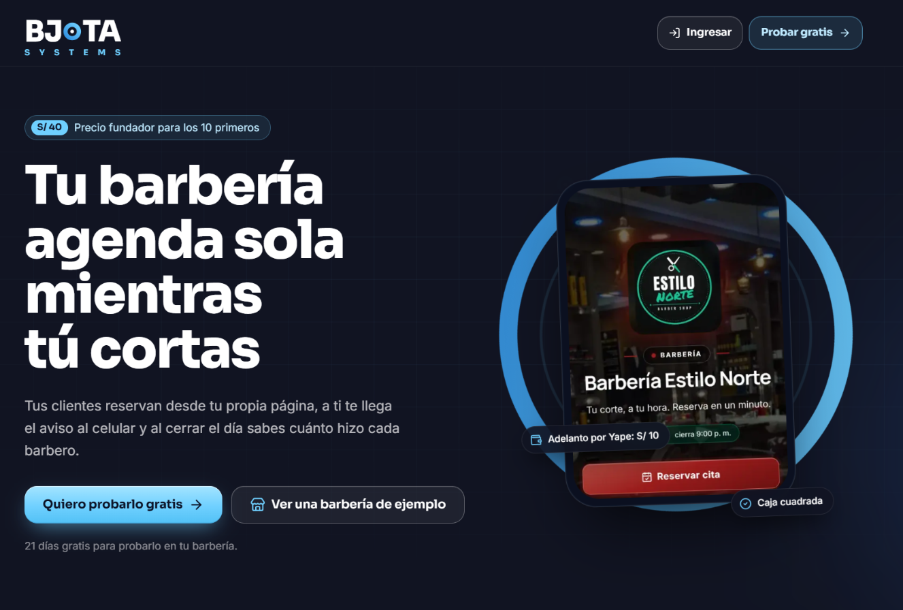

---

## El problema

Las barberías pequeñas (2 a 5 barberos) agendan por WhatsApp, cobran en efectivo, Yape o Plin y anotan en un cuaderno:

- **Contestar WhatsApp mientras cortan:** las citas se pierden o se cruzan.
- **Clientes que no llegan:** sin confirmación ni adelanto, una hora vacía es dinero perdido.
- **No saber cuánto hizo cada barbero** ni por qué método entró el dinero.
- **La caja no cuadra** al cerrar el día.

## La solución

| Para | Qué hace |
|---|---|
| **El cliente** | Página de la barbería con fotos, promociones y equipo; reserva en 5 pasos **sin crear cuenta**; adelanto por Yape o Plin |
| **El dueño** | Aviso push al celular por cada reserva; agenda por barbero (día, semana, mes, lista); confirmación por WhatsApp con un toque |
| **La caja** | Punto de venta por método de pago, devoluciones, propinas, apertura y cierre de caja, adelantos verificables |
| **Los números** | Reportes de producción por barbero, servicios y productos top, evolución diaria frente al periodo anterior |
| **La plataforma** | Multi-negocio con planes, accesos con vencimiento, invitaciones de un solo uso, auditoría y 25 videos de ayuda |

## Reservar en 5 pasos

| Servicios | Barbero | Día | Hora | Datos |
|---|---|---|---|---|
| 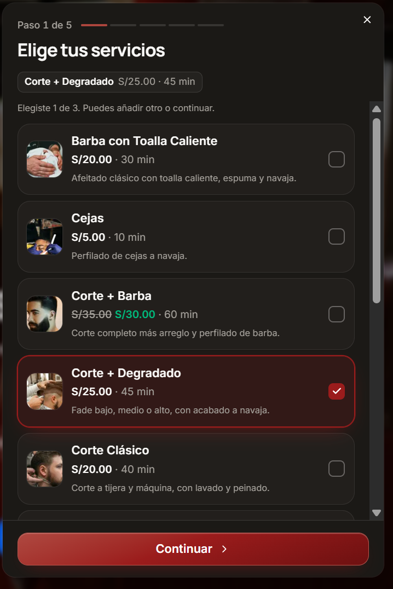 | 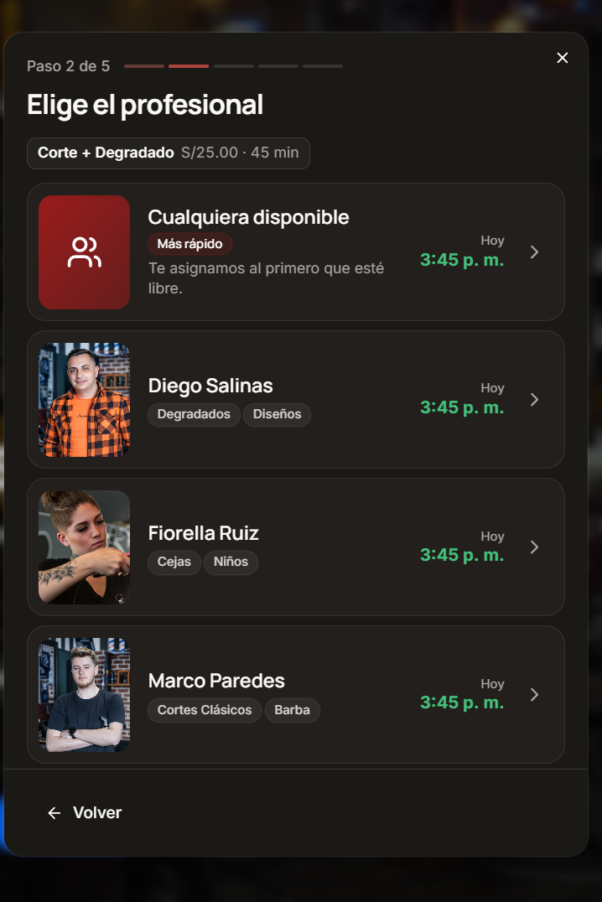 | 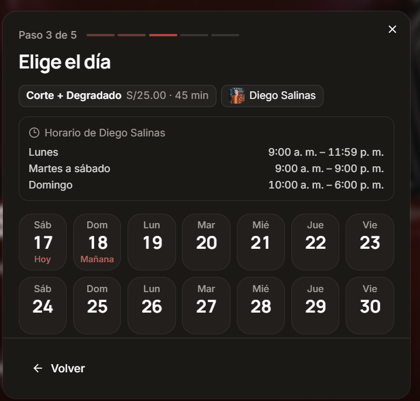 | 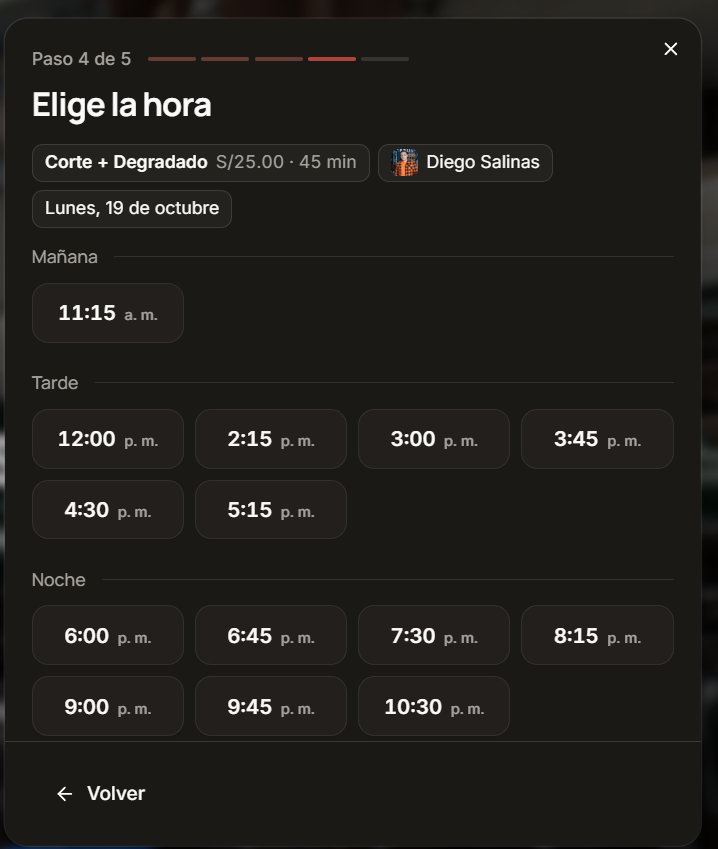 | 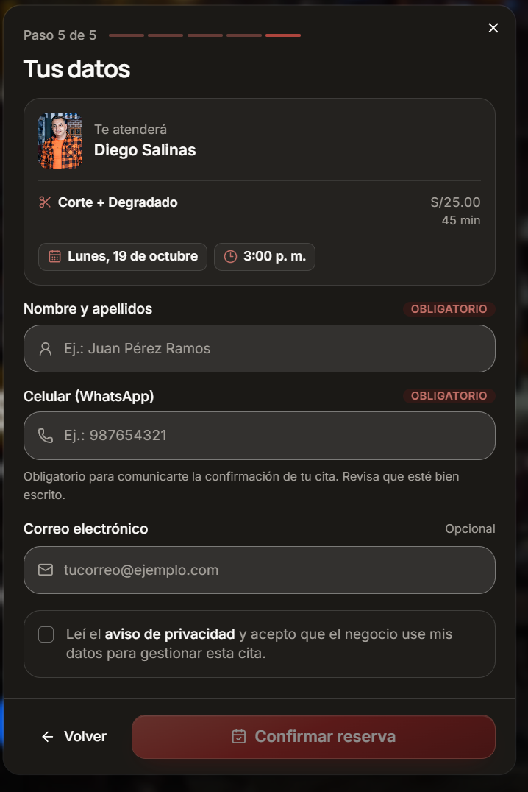 |

## El panel del negocio

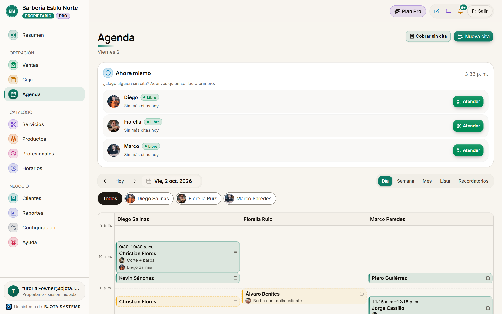

| Ventas por método de pago | Reportes por barbero |
|---|---|
| 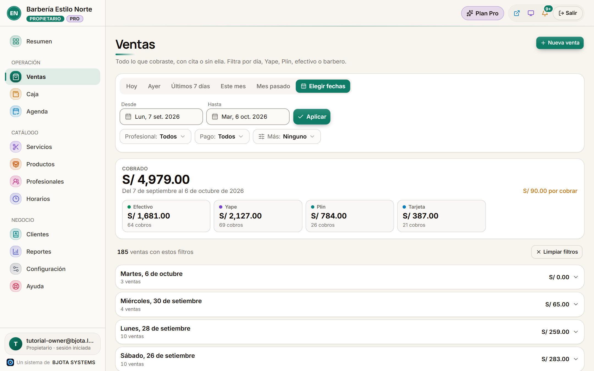 | 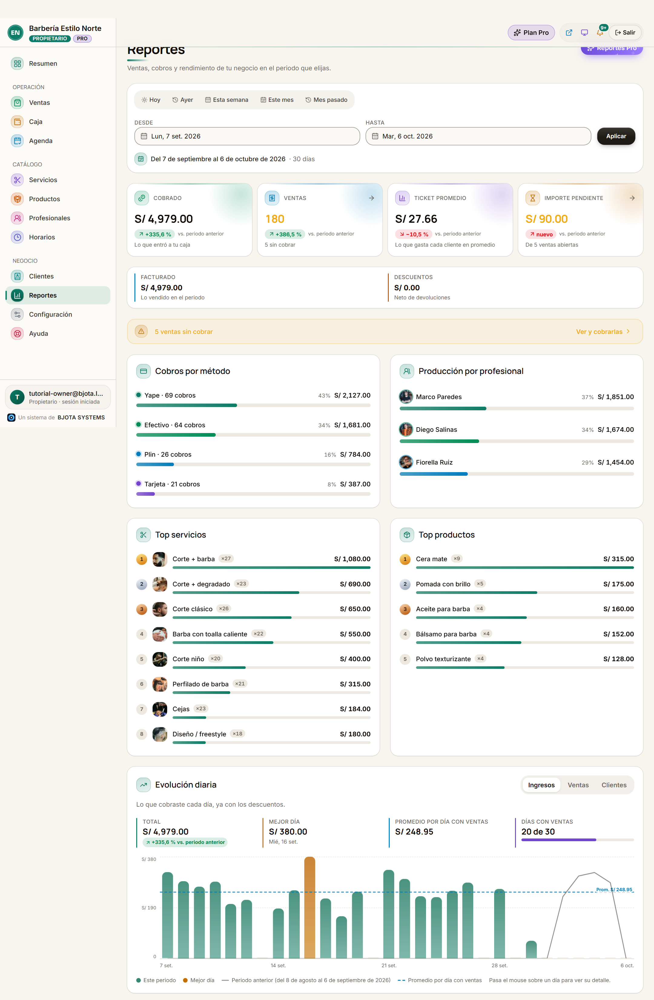 |

| Agenda semanal | Cierre de caja | En el celular |
|---|---|---|
| 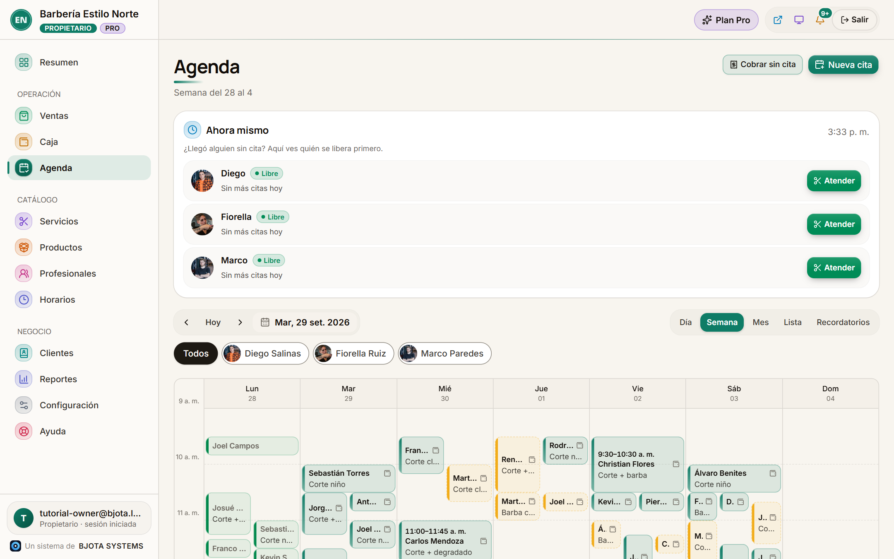 | 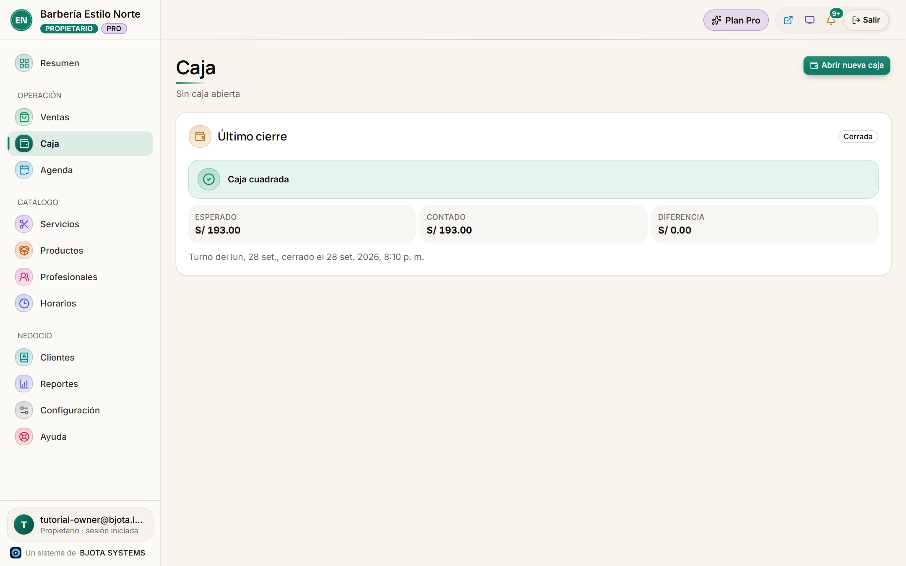 | 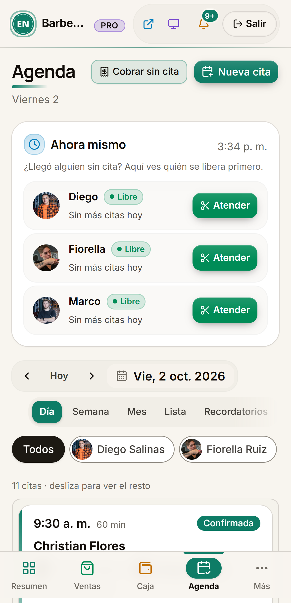 |

## Arquitectura

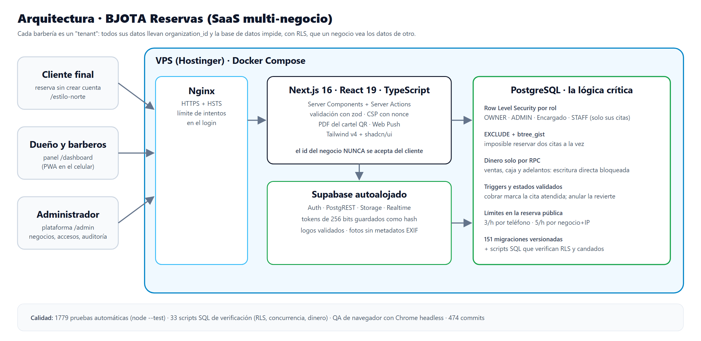

**Decisiones clave:**
- **Seguridad en la base de datos:** Row Level Security por negocio y por rol (dueño, administrador, encargado y barbero; el barbero solo ve sus citas). El id del negocio nunca se acepta del cliente.
- **El dinero solo se escribe por funciones RPC:** ventas, caja y adelantos bloquean la escritura directa, y un script comprueba que 60 intentos fallen.
- **Sin citas cruzadas:** una restricción `EXCLUDE` con `btree_gist` impide en PostgreSQL que dos citas del mismo barbero se solapen.
- **Reserva pública protegida:** límites por teléfono, por IP y por negocio, y una reserva pendiente por número.
- **Cabeceras de seguridad:** CSP con nonce y `strict-dynamic`, HSTS y límite de intentos de login en la app y en Nginx.
- **Autoalojado:** VPS Linux con Docker Compose (Supabase, Next.js en build standalone y Nginx), migrado desde Vercel y Supabase Cloud.

## Calidad

- **1779 pruebas automáticas** con `node --test`, todas pasan
- **151 migraciones** versionadas
- **33 scripts SQL** que verifican RLS, dinero, concurrencia y candados de acceso
- QA en navegador con Chrome headless, auditoría de seguridad documentada y **474 commits**

## Estado

- ✅ **En producción** desde septiembre de 2026, con sus primeras barberías de Trujillo.
- ⏳ **Pendiente:** correo transaccional (SMTP), copias de seguridad fuera del servidor y personalización completa de colores.

## Mi rol

Es un proyecto propio de principio a fin. Definí el producto con dueños de barberías, diseñé la base de datos y la arquitectura, desarrollé la app con apoyo de asistentes de IA y escribí las pruebas. También la desplegué en un VPS y doy soporte a los negocios que la usan.

---

> 🔒 **Repositorio vitrina:** no se publica el código fuente, los datos de clientes reales ni los detalles internos del servidor. Las capturas del panel provienen de una copia local con la barbería de demostración «Estilo Norte», con datos ficticios.

**Bryan Jeremy Espinoza Herrera** · BJOTA Systems · Trujillo, Perú
